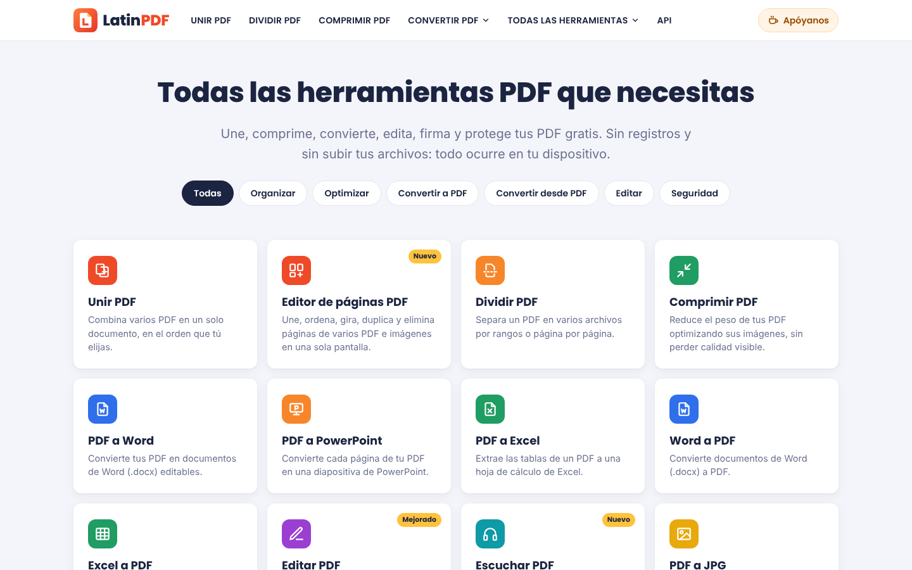
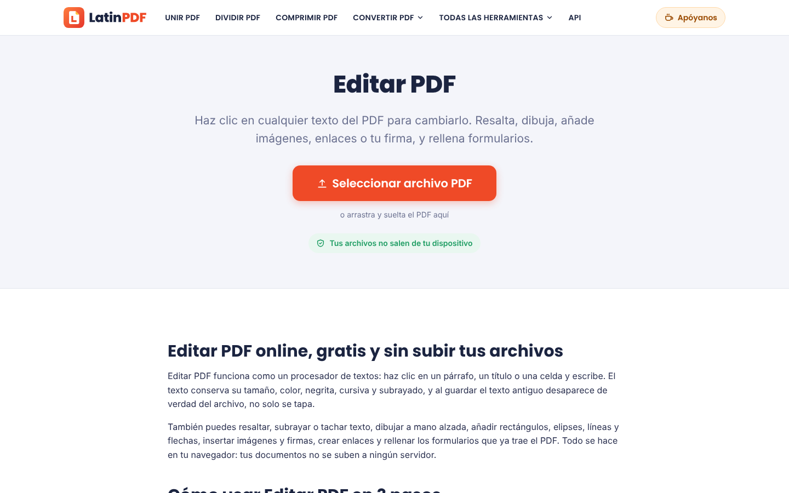
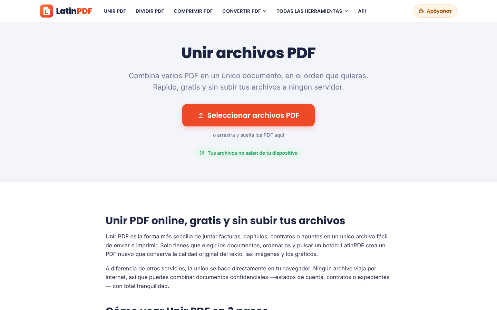
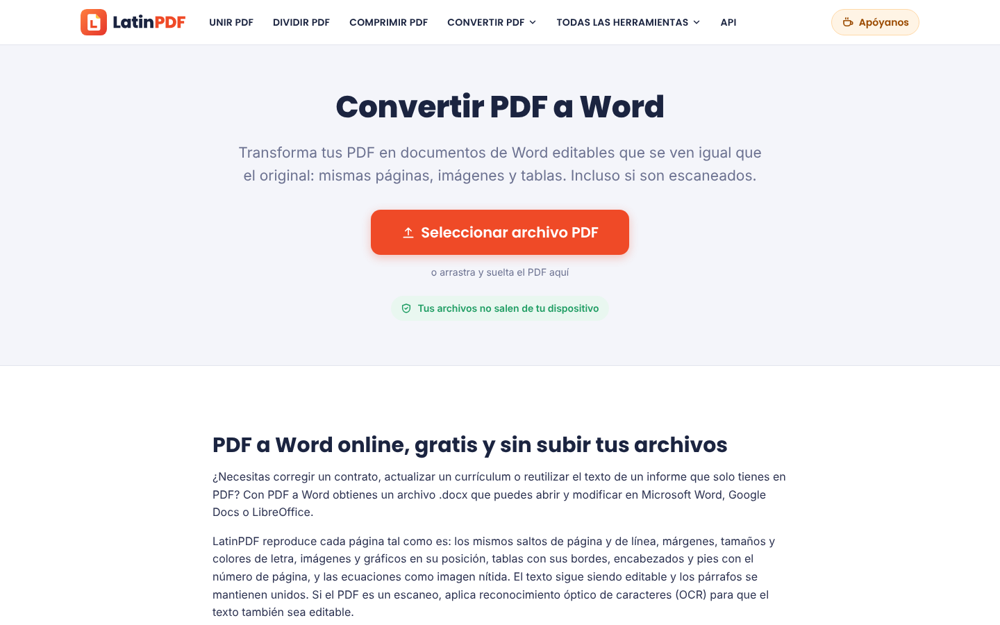
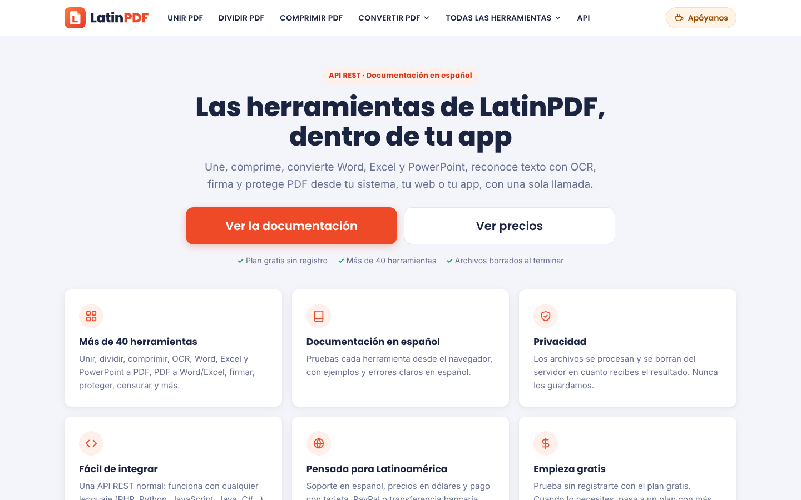
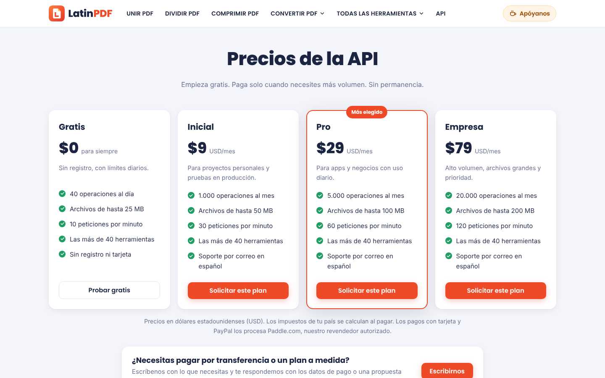
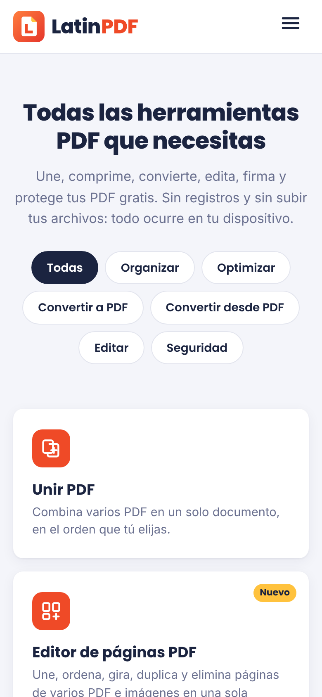
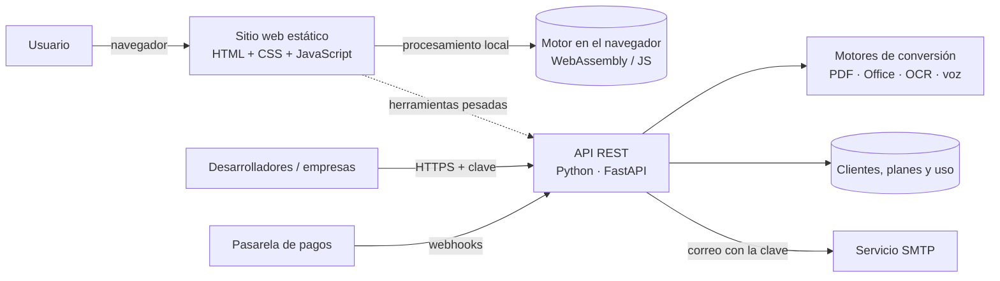

  

  <b>Plataforma de herramientas PDF en español, gratis y privada.</b> 
  Más de 40 herramientas en el navegador + una API REST de pago para desarrolladores.

  <a href="https://latinpdf.com"><b>🌐 latinpdf.com</b></a> ·
  <a href="https://latinpdf.com/api.html">API</a> ·
  <a href="https://latinpdf.com/precios.html">Precios</a>

---

> **Nota:** este repositorio es una **vitrina del proyecto** (portafolio). El código fuente es privado y no se
> publica aquí. Si te interesa el proyecto, una colaboración o una licencia de la API, escríbeme
> (ver [Contacto](#contacto)).

## ¿Qué es LatinPDF?

LatinPDF es una alternativa en español a servicios como iLovePDF o Smallpdf, pensada para Latinoamérica:

- **Privacidad primero:** la mayoría de herramientas se ejecutan **dentro del navegador** del usuario; los
  archivos no salen de su dispositivo.
- **Gratis y sin registro**, financiado con publicidad (Google AdSense) y donaciones.
- **API REST de pago** para empresas y desarrolladores que quieren integrar las mismas herramientas en sus
  sistemas, con planes mensuales, claves por cliente y cobro automático.
- **Todo en español:** interfaz, mensajes de error, documentación de la API y soporte.

## Herramientas

| Categoría | Herramientas |
|---|---|
| **Organizar** | Unir PDF · Dividir PDF · Editor de páginas · Organizar · Extraer páginas · Eliminar páginas · Rotar |
| **Optimizar** | Comprimir · Reparar · OCR (PDF escaneado → texto buscable) · PDF a PDF/A |
| **Convertir a PDF** | Word · Excel · PowerPoint · JPG/imágenes · HTML/página web · Escanear con la cámara del celular |
| **Convertir desde PDF** | Word (DOC/DOCX) · Excel · PowerPoint · JPG · HTML · Markdown · LaTeX (para Overleaf) |
| **Editar** | Editar texto del PDF · Marca de agua · Numerar páginas · Recortar · Escuchar PDF (texto a voz) · Comparar dos PDF |
| **Seguridad** | Firmar · Proteger con contraseña · Desbloquear · Censurar datos sensibles |

## Capturas

| Editar PDF | Unir PDF |
|---|---|
|  |  |

| PDF a Word | API para desarrolladores |
|---|---|
|  |  |

| Precios de la API | Versión móvil |
|---|---|
|  |  |

## Arquitectura

**Sitio web**
- Sitio estático multipágina (una página por herramienta, optimizada para SEO) servido desde hosting compartido.
- El procesamiento ocurre en el navegador con librerías de PDF, OCR, ofimática y fuentes ejecutadas en el cliente.
- Diseño responsive, banner de consentimiento de cookies, AdSense y analítica opcionales.

**API**
- Python + FastAPI, desplegada con Docker y un proxy inverso con HTTPS automático en un VPS Ubuntu.
- Más de 50 endpoints (`POST /v1/...` con `multipart/form-data`), documentación interactiva en español.
- Planes (Gratis, Inicial, Pro, Empresa) con cuotas mensuales, límites por minuto y tamaño máximo de archivo.
- Cobro automático con suscripciones vía webhooks, pagos manuales con vencimiento y envío de claves por correo.
- Herramienta de línea de comandos para administrar clientes, planes y configuración sin tocar código.
- Archivos temporales que se eliminan al terminar cada operación; límites de concurrencia y tiempo por trabajo.
- Suite de pruebas automatizadas.

## Tecnologías

**Frontend:** HTML5, CSS3, JavaScript, WebAssembly, PDF.js, pdf-lib, Tesseract.js
**Backend:** Python 3.13, FastAPI, Uvicorn, PyMuPDF, pikepdf, OCRmyPDF, LibreOffice, Tesseract, Piper TTS, SQLite
**Infraestructura:** Docker, Docker Compose, Caddy, Ubuntu 24.04, DNS/cPanel
**Negocio:** Google AdSense, Paddle (merchant of record), Brevo (SMTP), Ko-fi

## Contacto

**Eduardo Rincón** — Ingeniero Electricista · Desarrollo web y automatización
📧 contacto@latinpdf.com · 🌐 [latinpdf.com](https://latinpdf.com)

---

© 2026 Eduardo Rincón / LatinPDF. Las capturas y textos de este repositorio se muestran con fines de portafolio.
